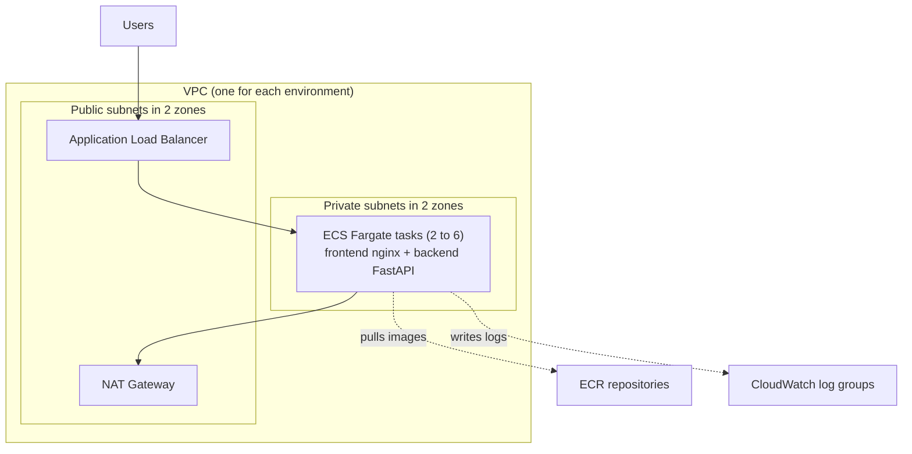
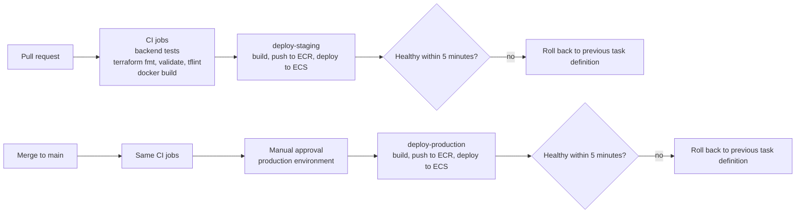
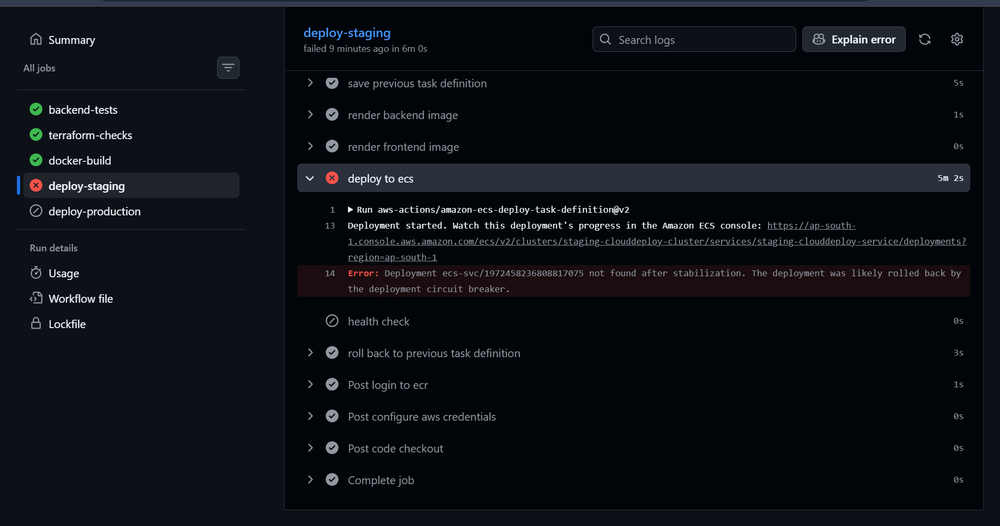

# infra-as-code-pipeline

Zero-touch deployments for the CloudDeploy app. Terraform builds the AWS infrastructure. GitHub Actions tests the code and deploys it to AWS ECS Fargate. Nobody runs commands on a production server.

This is Capstone Project 3 of DevOps Institute Mumbai (Terraform, GitHub Actions, AWS ECS).

## The problem

A company deployed by hand. One engineer logged in to servers, ran `git pull` and restarted services. A typing mistake in a config file caused an outage. This project replaces that with code review, automatic tests, an approval gate and an automatic rollback.

## What was built

| Project requirement | What is in this repo |
|---|---|
| Terraform modules | `networking`, `security`, `monitoring`, `compute` in `terraform/modules` |
| dev, staging and prod from the same code | Terraform workspaces plus one `.tfvars` file for each environment |
| Remote state with locking | S3 bucket with versioning and encryption. S3 native locking |
| CI/CD pipeline | `.github/workflows/ci.yml` |
| PR goes to staging, merge goes to production with approval | `deploy-staging` and `deploy-production` jobs. The `production` GitHub Environment needs a reviewer |
| Rollback if health fails within 5 minutes | ECS circuit breaker and a rollback step in the pipeline |
| Secrets not in code | GitHub Environment secrets |
| ECS health checks, auto scaling 2 to 6, CloudWatch logs | In the `compute` and `monitoring` modules |

## The app

CloudDeploy has two containers that run in one ECS task:

- `frontend`: React dashboard served by nginx on port 80
- `backend`: FastAPI on port 8000 with a SQLite database

nginx sends `/api/` requests to the backend. The backend host name comes from the variable `BACKEND_HOST`. It is `backend` in Docker Compose and `127.0.0.1` in ECS.

`docker-compose.yml` is only for running the app on a laptop. It is not used on AWS.

## Architecture



- Only the load balancer is public. The tasks have no public IP.
- The security group of the tasks allows traffic only from the load balancer.
- The load balancer health check calls `/api/health`.

### Terraform modules

| Module | Resources |
|---|---|
| `networking` | VPC, 2 public and 2 private subnets, internet gateway, NAT gateway, route tables |
| `security` | Security groups for the load balancer and the tasks, ECS task execution role, ECS task role |
| `monitoring` | CloudWatch log groups for frontend and backend with 14 days retention |
| `compute` | 2 ECR repositories, ECS cluster, task definition, ECS service, load balancer, target group, listener, auto scaling |

ECR tags are immutable. Images are scanned on push. Each environment creates about 37 resources.

## Pipeline flow



1. A pull request runs 3 CI jobs: `backend-tests`, `terraform-checks` and `docker-build`.
2. When they pass, `deploy-staging` builds both images and tags them with the commit id. It pushes them to ECR and deploys a new ECS task definition to staging.
3. After a merge to `main` the same CI jobs run. Then `deploy-production` waits until a reviewer approves it in GitHub.
4. After approval it deploys the same way to production.

`main` is protected by a ruleset. Code can only get in through a pull request and the 3 CI jobs must pass.

## Rollback

Each deploy job does this:

1. It saves the current task definition before the deploy.
2. It deploys the new task definition and waits up to 5 minutes for ECS to be stable.
3. It calls `/api/health` on the load balancer.
4. If anything fails after the deploy then a last step puts the service back on the saved task definition. The job still ends red, so a bad deploy never looks like a success.

The ECS deployment circuit breaker is also on with rollback. 

### Rollback test

I broke the backend start command on purpose. The deploy failed. ECS restored the previous task definition and `/api/health` stayed healthy. The circuit breaker acted first. The pipeline rollback step also ran and confirmed the same task definition.



I did not measure how many seconds the rollback took.

## Screenshots

| What | File |
|---|---|
| Staging deploy passed | `docs/deploy-staging.png` |
| Waiting for production approval | `docs/manual-approval.png` |
| Production deploy passed | `docs/deploy-production.png` |
| Staging dashboard | `docs/dashboard-staging.png` |
| Production dashboard | `docs/dashboard-prod.png` |
| CloudWatch logs | `docs/cloudwatch-logs.png` |
| ECS service with 2 running tasks | `docs/ecs-service.png` |

## Setup instructions

You need an AWS account, the AWS CLI, Terraform 1.11 or newer, Docker and Git. Do not use the AWS root account.

### 1. State bucket (one time, by hand)

Terraform cannot create the bucket that holds its own state.

```bash
aws s3api create-bucket --bucket <STATE_BUCKET_NAME> --region ap-south-1 \
  --create-bucket-configuration LocationConstraint=ap-south-1
aws s3api put-bucket-versioning --bucket <STATE_BUCKET_NAME> --versioning-configuration Status=Enabled
aws s3api put-public-access-block --bucket <STATE_BUCKET_NAME> \
  --public-access-block-configuration BlockPublicAcls=true,IgnorePublicAcls=true,BlockPublicPolicy=true,RestrictPublicBuckets=true
```

Put the bucket name in the `backend "s3"` block in `terraform/capstone3-tf/main.tf`.

### 2. Workspaces

```bash
cd terraform/capstone3-tf
terraform init
terraform workspace new dev
terraform workspace new staging
terraform workspace new prod
```

Always check the workspace before a plan or apply:

```bash
terraform workspace show
```

The workspace name must match the file: `envs/<workspace>.tfvars`.

### 3. First environment (example: staging)

The ECS service needs an image that already exists. So the first image is pushed by hand. Every later deploy is done by the pipeline.

```bash
terraform workspace select staging
terraform apply -var-file=envs/staging.tfvars -target=module.compute.aws_ecr_repository.app

REGISTRY=<ACCOUNT_ID>.dkr.ecr.ap-south-1.amazonaws.com
aws ecr get-login-password --region ap-south-1 | docker login --username AWS --password-stdin $REGISTRY
docker build --platform linux/amd64 -t $REGISTRY/staging-clouddeploy-backend:v1 ./backend
docker push $REGISTRY/staging-clouddeploy-backend:v1
docker build --platform linux/amd64 -t $REGISTRY/staging-clouddeploy-frontend:v1 ./frontend
docker push $REGISTRY/staging-clouddeploy-frontend:v1

terraform apply -var-file=envs/staging.tfvars -var="image_tag=v1"
terraform output -raw alb_dns_name
```

Do the same for `prod` with `prod` in all names.

### 4. GitHub settings

Create the GitHub Environments `staging` and `production`. In `production` add a required reviewer.

In each environment add:

| Type | Name | Value |
|---|---|---|
| Secret | `AWS_ACCESS_KEY_ID` | Access key of the pipeline IAM user for that environment |
| Secret | `AWS_SECRET_ACCESS_KEY` | Secret key of that user |
| Variable | `AWS_REGION` | `ap-south-1` |
| Variable | `ALB_URL` | `http://<ALB_ADDRESS>` without a slash at the end |

Each environment has its own IAM user. The policy allows only: ECR push to that environment's repositories, registering task definitions, updating that environment's ECS service and passing that environment's two task roles.

`ALB_URL` changes every time an environment is recreated.

### 5. Protect `main`

Create a ruleset for the default branch. Require a pull request and the status checks `backend-tests`, `terraform-checks` and `docker-build`. Block force pushes and deletions.

### 6. Stop the cost

```bash
terraform workspace select <env>
terraform workspace show
terraform destroy -var-file=envs/<env>.tfvars
```

## Runbook

**CI job is red**
- Open the failed step and read the first red line.
- `terraform fmt -check` fails: run `terraform fmt -recursive` in the `terraform` folder.
- `tflint` fails: fix the warning. Provider and Terraform versions must be pinned.
- Backend tests fail: run `python -m pytest -q` in `backend`.

**Deploy failed and the service rolled back**
- Check that the service runs the previous task definition:
  `aws ecs describe-services --cluster <env>-clouddeploy-cluster --services <env>-clouddeploy-service --query "services[0].taskDefinition"`
- Read the ECS events and the CloudWatch log groups `/ecs/<env>/backend` and `/ecs/<env>/frontend`.
- Fix the code and push a new commit. Image tags are immutable. A tag cannot be pushed twice.

**Manual rollback**
```bash
aws ecs update-service --cluster <env>-clouddeploy-cluster \
  --service <env>-clouddeploy-service --task-definition <PREVIOUS_TASK_DEFINITION_ARN>
```
The previous task definition ARN is printed in the log of the step `save previous task definition`.

**Health check step fails but the app works**
- `ALB_URL` is probably old. Read the new address with `terraform output -raw alb_dns_name` and update the variable in the GitHub Environment.

**Tasks do not start**
- Read the ECS service events.
- Check that the image tag exists in ECR.
- Check that the task execution role exists and the NAT gateway is available.

**Load balancer returns 502 or 503**
- Look at the target group health in the console.
- `/api/health` must return 200 through nginx.
- `BACKEND_HOST` must be `127.0.0.1` in the task definition.

**Pipeline says AccessDenied**
- Compare the denied action with the IAM policy of that environment's pipeline user. Add only that action.

**Terraform state lock error**
- Check that no Terraform process is running. Then `terraform force-unlock <LOCK_ID>`.

**Destroy fails**
- ECR repository not empty: delete the images or use `aws ecr delete-repository --force`.
- Load balancer deletion protection on: turn it off first.

## Cost estimate

These are estimates. I did not run the environments for a full month.

Assumptions: region `ap-south-1`, 730 hours in a month, 2 tasks with 0.5 vCPU and 1 GB each (the minimum of the auto scaling group), little traffic.

| Item | Rate used | Monthly for one environment |
|---|---|---|
| Fargate compute, 2 tasks | $0.04048 per vCPU hour and $0.004445 per GB hour | about $36 |
| NAT Gateway | $0.056 per hour | about $41 |
| Application Load Balancer | $0.0239 per hour | about $17 |
| **Total, fixed part** | | **about $94** |

- If auto scaling goes to 6 tasks the compute part is about $108 and the total is about $166.
- Three environments running all month would cost about three times the fixed part.
- The fixed part costs about $0.13 per environment per hour. That is why the environments were destroyed after testing.
- Not counted: data transfer, NAT data processing, load balancer capacity units, CloudWatch log storage, ECR storage, public IPv4 address fees and the S3 state bucket. They are small in this project.
- The Fargate rates are the us-east-1 rates. I did not find the Mumbai rate, and it may be higher. The NAT and load balancer rates are for Mumbai from a public pricing site. Check the AWS Pricing Calculator before you rely on these numbers.

## Limits of this project

- Locking: Terraform S3 native locking is used. DynamoDB locking is deprecated in Terraform.
- Traffic is HTTP only. HTTPS needs a domain name and a certificate.
- The API has no login. Anyone with the load balancer address can read the deployments.
- SQLite lives inside the task. The data is lost when a task is replaced and the 2 tasks have separate databases.
- There is one NAT gateway. If its zone fails the private subnets lose internet access.
- The nginx image runs as root.
- The dashboard chart, availability and request numbers are demo data. The deployment records are real.
- The pipeline users use long-lived access keys stored in GitHub Secrets. This is simple but a leaked key is a risk. A safer next step is OIDC.
- Staging is one shared environment. Two open pull requests overwrite each other.
- The first image of each environment is pushed by hand.
- Load balancer deletion protection is off in prod so that the capstone could be destroyed. A real production environment keeps it on.
- Stretch goals are not done: Trivy, tfsec, plan comments on pull requests, Slack and cost estimation in the pipeline.
